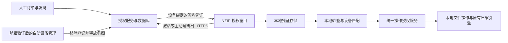

# NZIP 收费版轻量授权设计 v1.2

日期：2026-10-11。适用分支：`paid-version`。
状态：已按用户确认的自动解绑策略修订并完成补充静态评审，尚未实现。
相关文档：[补充评审 v2](design-review-v2.md)、[历史设计 v1.1](design-v1.1.md)、[初版 v1.0](design-v1.md)、[历史评审 v1](design-review-v1.md)。

## 1. 产品原则

减少随手转发共享，保留轻量软件的使用体验。客户完成激活后，压缩、解压和文件操作都在本地执行，不需要周期联网、登录账号或后台常驻进程。

允许任何人获得和安装程序。未激活时可以浏览压缩包目录和文件列表，收费操作需要有效凭证。签名凭证绑定指定 Windows 安装实例，直接复制到其他正常客户端不能获得授权。

第一版不承诺防修改破解、严格并发台数限制、永久离线凭证的即时撤销、抵抗管理员伪造系统标识或完整系统克隆。用户已明确接受客户反复解绑、重新激活后可能积累多个有效离线副本的风险。服务器限制的是当前登记占位数，不是历史凭证数或实际离线运行台数；不以该风险取消自助换机。

自动解绑、成功后释放名额及长期离线使用已由用户确认。默认 3 个登记名额仍为首发建议，价格和正式售后条款尚未确定。

## 2. 首发业务规则

| 项目 | 规则 |
| --- | --- |
| 售卖单元 | 一个付费订单对应一份 NZIP 商业版授权；前期人工收款、人工关联订单发码 |
| 默认额度 | 默认最多登记 3 个 active Windows 安装实例；解绑后释放登记名额，不设累计发证次数上限 |
| 激活方式 | 首次输入授权码并联网；不要求创建账户 |
| 正常使用 | 有效凭证长期离线可用，无定期校验、使用次数或文件大小限制 |
| 重复激活 | 同授权、同实例重复安装软件或重试请求不消耗额外额度 |
| 新设备与换机 | 有空位直接激活；满额时客户自助选择旧登记解绑后激活新实例，不要求常规换机找人工 |
| 解绑 | 本机可主动解绑；旧设备丢失时通过购买邮箱验证后自助管理。服务器事务成功后立即释放一个登记名额 |
| 异常分享 | 重试、重装、常规换机和解绑次数本身不作封禁依据；仅对明显自动化攻击短暂限流，必要时人工核实，不远程关闭有效离线副本 |
| 退款 / 泄露 | 可停发新实例授权或更换激活码；已有永久离线凭证无法即时撤回 |
| 授权归属 | “关于 / 授权”页显示客户编号和授权编号末尾；不显示手机号、收件邮箱或原始机器标识 |
| 用户文件 | 文件内容、文件名、压缩包备注均不加入授权水印，不上传用户文件 |

销售文案建议：“一份授权可登记 3 台设备，支持自助解绑换机，激活后可长期离线使用”。需要说明登记名额与实际离线副本的区别，不承诺解绑会强制停止所有旧副本。NZIP 不采用离线激活后的强制换机等待期。

## 3. 客户操作流程

安装完成即可启动。未激活时主窗口保留目录浏览；用户首次执行收费操作时，显示一次简洁授权窗口，包含授权码输入、激活、导入设备授权文件及联系售后入口。

成功后显示“已激活，可长期离线使用”和客户编号。以后启动只验证本地凭证，不请求授权服务，不按启动次数弹窗。授权详情从菜单进入。

网络错误只影响本次激活请求，明确提示重试或联系卖家。不删除已有有效凭证，不擅自转换成试用到期状态。首次激活全程可取消，不创建压缩或解压任务。

本机授权页提供“解除本机授权”，联网提交成功后清除当前用户可访问的本地凭证和进程授权状态，立即释放登记名额。已经开始的文件任务允许完成，新任务需要重新激活。不能联网时保留现有授权与占位，显示“尚未解绑”，不谎报成功。

旧设备损坏、系统重装或无法访问时，客户从购买邮箱取得一次性管理验证码，自助查看已登记设备并移除旧登记，再激活新实例。无需注册账户，也无需常规换机人工审批。该远程移除不要求旧设备在线，不承诺旧设备缓存失效。

远程管理权限通过订单绑定邮箱核验，不能只凭可分享的授权码移除其他设备。客户有意同时分享授权码和邮箱验证信息属于已接受的主动共享风险；人工售后仅处理邮箱无法访问、订单信息错误等例外。

纯离线客户可以导出只含请求编号、设备摘要和产品标识的申请文件，由卖家核验订单后发放签名设备凭证。该申请文件不包含授权码，也不证明付款或设备所有权；签发前仍需订单核验。

## 4. 架构与实现范围

客户端沿用 C# / .NET Framework 4.8 / Windows Forms，使用 Windows 自带密码学能力。服务端建议单实例 ASP.NET Core + SQLite + HTTPS 反向代理，初期不接支付系统。

首发包括订单关联、发码、激活、本机解绑、邮箱验证后的自助设备管理、例外恢复及审计；后台可调整登记额度和暂停新激活。不建设账户体系、订阅账单、云压缩、机器学习风控、复杂防调试或强制 TPM 依赖。

业务代码必须通过统一授权服务取能力状态，不能分别在窗口、菜单与队列里维护“是否付费”布尔值。

## 5. 设备识别与恢复

第一版将“设备”定义为一次 Windows 安装实例。使用 64 位注册表视图读取 Windows 安装标识 MachineGuid，规范化后计算 `SHA256("NZIP-paid:device:v1|" + normalizedId)`。服务器只接收该摘要，不接收原始标识、用户名、MAC 地址或磁盘文件。

该标识用来限制普通复制，不是可靠的硬件身份证或远程设备证明。同一个 Windows 安装实例中，不同用户与同用户重装 NZIP 使用同一设备摘要；完整克隆系统可能产生相同摘要。Windows 重装可能改变摘要，通过自助管理移除旧登记再激活，不承诺自动识别同一块主板。

每次进程验证授权时从实际系统读取标识。不能仅信任缓存里声称的 deviceDigest。标识为空或读取失败时不生成 `unknown` 等通用值，也不静默换成客户端任意指定的 UUID；新激活显示可恢复错误，售后帮助检查系统配置。

本地 DPAPI 缓存按当前用户保护。同一 Windows 实例切换用户，可以重新激活取得同一登记凭证，或导入该实例的签名设备凭证，再按新用户重新保存，不能因此增加发证名额。导出的签名凭证本身不含激活码，复制到不同实例仍须通过设备匹配。

授权读取故障不改写、删除好凭证。已开始任务不因后续读取故障中止。已有凭证但暂时无法匹配设备时，提供明确恢复入口，不误报成“授权码不存在”。

## 6. 凭证协议

激活码：密码学安全随机数，至少 128 位随机强度；分组显示。服务器保存带独立服务端密钥的 HMAC 摘要，用于核验。激活码作为持有者凭据对待，传输只走 HTTPS；不进入 URL、普通日志、客户端配置备份或自动错误报告。

签名设备凭证：外层只有 `keyId`、`payload`、`signature`。后两项使用 Base64URL；载荷为 UTF-8 JSON，至少包含以下字段：

| 字段 | 含义 |
| --- | --- |
| `schema` | 协议版本，首发为 1 |
| `product` | 固定为 `nzip-paid`，与免费版区分 |
| `licenseId` / `grantId` | 订单授权编号 / 本次发证的唯一编号 |
| `bindingId` / `generation` | 设备登记编号 / 该登记每次重新激活递增的代次，用于服务端变更一致性 |
| `customerRef` | 对外客户编号，不使用邮箱或电话号码 |
| `deviceDigest` | 实际绑定的 Windows 安装实例摘要 |
| `entitlement` | 首发固定 `desktop-core`，由客户端映射到能力表 |
| `issuedAt` | 签发时间，用于显示和审计，不作为离线到期或回拨封锁条件 |

首发没有 expiresAt，不绑定精确应用小版本；兼容的商业版维护更新继续验证已有凭证。未来商业大版本如何售卖另行确定，不隐含在本协议里。

签名固定使用 RSA-3072、SHA-256、PKCS#1 v1.5，对 `UTF8("NZIP-LICENSE-V1") + 0x00 + 原始payload字节` 签名。客户端必须先用 keyId 对应的可信公钥验证原始字节，再解析载荷并核对产品、协议、能力与当前设备。不能重序列化 JSON 后验签，不能让载荷指定验证算法或自带可信公钥。

文件及响应上限 16 KiB，限制 JSON 深度与字段长度；拒绝重复字段、未知 keyId、错误 schema/product/entitlement、缺失字段、未知字段和非法编码。keyId 本身仅选择客户端内置公钥，签名必须与该公钥吻合；协议扩展使用新的 schema，不静默接受改变权限语义的字段。

数字签名用于验证来源及完整性，DPAPI 用于本地存储保护，两者不能相互替代。[微软签名文档](https://learn.microsoft.com/en-us/dotnet/standard/security/cryptographic-signatures)、[微软 DPAPI 文档](https://learn.microsoft.com/en-us/dotnet/standard/security/how-to-use-data-protection)

## 7. 本地状态与存储

授权存放在当前用户独立的 NZIP Paid 授权目录，原子替换写入 DPAPI CurrentUser 保护的缓存。不从 preferences.json / desktop.json 导入付费状态，不因更换普通配置目录或清空历史获得额外权限。

状态只有：未激活、有效、凭证损坏、设备不匹配、设备不可读取。没有因为不能联网而进入的“已过期”状态。错误文案说明可采取的动作，不要求客户重装整个软件。

进程启动后读取小文件，进行一次验签和系统标识匹配；成功后在内存缓存不可变的授权能力。新操作从该服务取状态，导入新凭证时重新验证后原子切换。应用启动与操作授权不发网络请求、不调用 WMI、不同步加载网页。

未成功验证的新凭证不能替换已有有效凭证。没有授权时不能将任务加入执行队列；已经准入的任务保留该次授权快照直至结束，取消操作始终可用。本机解绑成功后不允许再接收收费任务，当前已准入任务继续完成。重新导入解绑前备份的有效离线凭证仍可能恢复使用，该风险明确接受，不增加隐藏联网检查。

## 8. 能力与入口矩阵

| 能力 | 未激活 | 已激活 |
| --- | --- | --- |
| 浏览目录树、文件列表、排序、搜索、文件名代码页、已有元数据与属性 | 可用 | 可用 |
| 安装/升级/卸载、shell 注册、设置、帮助、授权管理、取消任务 | 可用 | 可用 |
| 定位原包、原包文件管理 | 保留现有确认与权限规则 | 同左 |
| 新建压缩包、添加/删除/重命名包内条目、修改注释 | 需要激活 | 可用 |
| 解压、批量解压、复制真实包内文件到剪贴板 | 需要激活 | 可用 |
| 内置内容预览、提取临时副本并用本地程序打开 | 需要激活 | 可用 |
| 完整性测试、恶意软件扫描、修复、密码恢复 | 需要激活 | 可用 |

目录浏览可能需要内部展开压缩 TAR 的中间容器，仍允许这一内部读取过程；不能把所有底层 7z 命令统一视为用户解压并阻断。

GUI 负责说明状态，核心公开操作入口负责准入。ArchiveEngine 的用户写入/提取/测试入口、ArchiveTools / ArchiveScanner 的独立操作以及 RPC 都使用同一服务；免费操作采用明确白名单，新增未知操作默认需要授权。

必须覆盖 `Program --engine-rpc`、Backend 队列和快捷提取、Preview、CopyFiles、OpenEntry、右键与命名管道转交。安装与注册专用参数不获得文件操作权限。不能以隐藏按钮、环境变量、修改系统时间或导入设置代替验证。

正式版只信任正式公钥；测试签名与正式签名分离。`NZIP_TEST_MODE`、`NZIP_USER_DATA`、`NZIP_7Z_PATH`、调试参数和自定义服务地址都不能绕过授权。测试构建可以用测试发行者，正式安装包不得包含测试信任根、签发私钥或免激活参数。

免费 7-Zip 组件本身按原许可工作，不修改引擎为收费引擎。客户自行使用免费软件不属于 NZIP 授权控制范围。

## 9. 发证服务与一致性

公开接口包括激活、本机解绑、购买邮箱验证码及该邮箱验证后的设备列表/移除操作。首发不提供未认证的设备列表或仅凭设备编号解绑的接口。客户端不能声明自己已付款、可用额度或管理权限。

数据库保留 orders、licenses、activationCodes、deviceBindings、deviceGrants、mutationRequests、managementSessions、adminAudit。deviceBindings 对 (licenseId, deviceDigest) 唯一，状态为 active/deactivated；generation 每次重新激活递增。deviceGrants 保留各次发证历史，解绑不删除历史或宣称旧签名已失效。占位数只计算 active 记录。

激活与解绑都使用 SQLite 写事务串行处理，同一个 requestId 绑定操作类型、授权、请求内容及目标代次：

1. 激活 active 的同一实例，返回当前代次的原凭证，不增加占位。激活 deactivated 的实例也必须重新检查空位，不能凭“以前激活过”越过上限。
2. 新实例或重新激活的实例，有空位才设为 active；生成新 grantId 和当前 generation 的凭证，登记、保存响应并提交成功后返回。签名或提交失败整体回滚。
3. 本机解绑需要该绑定的设备管理令牌；远程移除需要经购买邮箱验证的、仅对本授权有效的管理会话。每次操作核对 bindingId 和 generation，只把匹配的 active 记录改为 deactivated。
4. 重复解绑返回“该登记已解除”，不会再次减少计数。旧代次的延迟解绑请求不能移除已经重新激活的新代次。
5. 响应丢失可用相同请求编号重试。缓存激活响应已不属于当前 active 代次时返回状态已变化，要求客户端创建新的激活请求，不能把旧响应解释为重新占位成功。
6. 解绑提交成功但响应丢失时，客户端重试/查询同一操作即可确认结果，再清理本地凭证；未确认服务端成功前保留已有授权。不采用先删本地授权再请求服务器的流程。

设备管理令牌为独立随机秘密，随当前代次的激活响应交付，在客户端 DPAPI 缓存保存、服务端保存核验摘要；不写入可导出的签名设备证书。为重放幂等响应而保留的令牌使用独立服务端密钥加密存储，不能作为明文普通日志或普通响应缓存落盘。旧代次令牌不能管理新代次；同代次恢复可签发新的受限令牌，所有旧代次权限在代次更新时一并失效。验证码与网页会话只管理对应订单授权，不具有后台管理员权限。离线导入证书或令牌丢失时，使用购买邮箱验证后的设备管理完成解绑，不要求先占用一个新名额。

购买邮箱验证码建议有效期 10 分钟、最多 5 次尝试、发送间隔至少 60 秒；验证码单次使用，验证后管理会话有效期 15 分钟。统一响应避免泄露订单是否存在；授权码、验证码、设备管理令牌与会话均不写入日志。网页会话使用安全 cookie、请求防伪校验，不将第三方网页脚本嵌入管理页。邮箱核验不影响日常离线使用。

不设普通换机冷却期、累计激活次数封锁或 Typora 离线令牌式的六个月锁位。保护服务容量的短暂限流与故障重试保留，但不能用换机频繁直接判定盗版。并发操作提交后的 active 登记数必须不超过额度；已发出的历史离线凭证数量允许超过额度。

错误区分网络失败、授权不存在、登记名额已满、暂停新实例激活、管理验证失败、操作代次已变化与服务故障。满额提示用户打开自助设备管理，而非必须购买更多授权或联系客服。

使用 HTTPS、服务器端权限校验、输入限制和限流；管理员接口使用独立身份验证及最小权限，操作记录审计，客户授权码不能调用管理功能。[OWASP REST 安全建议](https://cheatsheetseries.owasp.org/cheatsheets/REST_Security_Cheat_Sheet.html)

## 10. 运维与人工恢复

管理员可以关联订单、生成和轮换激活码、调整登记额度、暂停新增激活、查看绑定状态、历史发证及管理审计。客户常规设备移除由自助流程处理，不经人工批准。轮换激活码后，已有本地凭证继续有效。

签名私钥只由服务端/卖家受控签发工具访问，不出现在 Git、客户端、安装包和测试 fixture。管理员不能从普通日志导出批量激活码。密钥与数据库加密备份，分别控制访问，发布前演练恢复。

公钥通过可信客户端维护更新轮换；保留旧公钥验证已有永久凭证。私钥泄露后不能指望永久离线客户端立即获知吊销，必须作为被接受的方案限制记录，并停止使用泄露私钥签新证。

服务停机不影响已激活设备。需要人工离线发证时，由卖家受控工具签发并保存发证台账；数据库恢复后先补入台账再开放自助发证。离线人工发证仍须登记占位，恢复服务前对齐绑定状态。服务器停机时不能自助释放名额；已有客户继续离线使用，售后处理紧急新机需求。历史凭证保持有效，不能据此宣称全局严格三设备运行限制。

客户文件、文件列表、压缩密码不进入授权服务。请求日志隐藏授权码和请求正文，审计仅保存必要的订单引用、客户编号、设备摘要、事件与操作人；明确保留周期，并在售卖说明里告知设备摘要用途。

## 11. 发布隔离与许可

商业版使用独立 productId、程序集/窗口标识、安装 UpgradeCode、安装目录、用户配置及授权目录、mutex/pipe 命名空间和 Windows 注册键。与免费 NZIP 0.6.2 并存，升级或卸载不能误维护另一版本。便携版与安装版在同一 Windows 实例可复用授权，不产生两个发证登记。

新收费机制只适用于新商业版，不把旧版 0.6.2 的现有行为改成收费。商业版安装时可以添加自己的打开方式入口，由用户选择默认应用。

现有工程 LICENSE 与 package 元数据标为 MIT。发布前需明确自有代码商业许可、授权与售后条款，保持既有版本和第三方许可独立。7-Zip 可商业使用，相关许可信息必须随组件保留；不向客户声称免费引擎本身是独家收费技术。[7-Zip 官方许可](https://www.7-zip.org/license.txt)

## 12. 实施顺序与验收

1. 先实现签名凭证、本地授权状态、能力矩阵与所有入口覆盖，使用隔离测试签名验证跨实例复制和伪造场景。
2. 实现交易一致的激活/解绑服务、设备代次、邮箱验证及自助设备管理；先跑通人工订单、发码、激活、移除、换机的完整流程，再决定支付集成。
3. 实现激活窗口、本机解绑、设备管理入口、设备授权导入/导出、例外恢复文案与商业版独立打包。
4. 执行补充评审中的激活/解绑并发、重复和延迟请求、响应丢失、备份恢复、远程移除、多用户及断网验收；沿用历史评审的核心入口、密钥隔离、性能和升级/卸载验收。

性能目标：同机交错采集免费 0.6.2 与商业版各 30 次可交互启动，商业版 P95 增量不超过 100 ms。明确外部与窗口内计时口径，记录失败和离群样本；验签失败与未激活也不能卡住首帧。启动路径网络请求数为 0，不新增浏览器运行时或常驻服务。

上述是待实施验收条件，没有已通过的性能、安全或授权功能测试。发布前还需填写价格、购买渠道、售后联系方式、部署域名和正式密钥配置。

## 13. 本次已接受的产品取舍

用户明确确认：“可以接受这种风险，允许客户自动解绑、释放名额并换机。”本次以该决策替代 v1.1 的累计发证额度和常规人工换机审批。

客户端主动解绑成功时清除当前用户可访问的授权；远程解绑和备份恢复不能保证旧副本停止。旧用户缓存、完整备份、其他用户配置中的凭证可能继续工作，不将这些情形当作实现验收失败。验收重点是当前登记名额与自助操作一致，而非所有历史副本最多三台运行。

## 14. 与 Typora 的公开规则对照

Typora 官方文档支持每份授权最多激活 3 个设备，并可从旧设备或网页管理入口停用旧登记换机。其官方离线令牌激活规则另有至少六个月占位限制。不同 Windows 用户的计数规则也不同于本方案，不能将 NZIP 称为完全复刻其授权实现。[Typora 激活说明](https://support.typora.io/activation/)、[Typora 离线激活说明](https://support.typora.io/Offline-Activation/)

NZIP 借鉴自助激活和设备管理的使用体验，按用户确认保留更宽松的永久离线和自助解绑规则，不推测 Typora 未公开的内部撤销或联网校验实现。上述对照核对日期为 2026-10-11。
