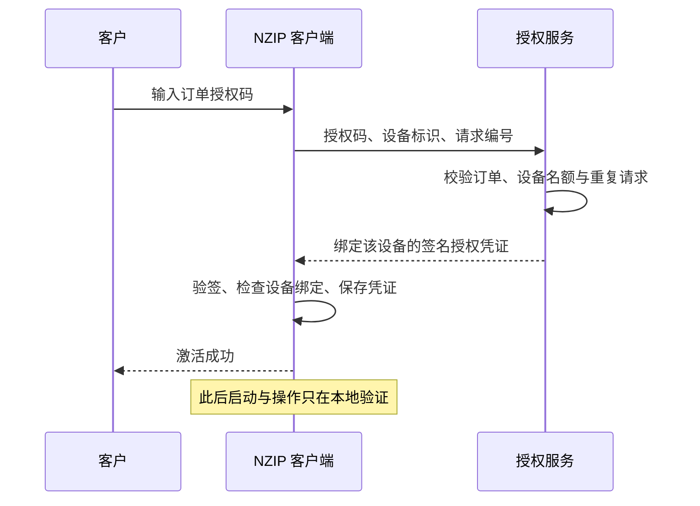

# NZIP 收费版轻量授权设计 v1.0

日期：2026-10-11。基线：NZIP 0.6.2，`paid-version` 分支。
状态：第一版设计，供评审使用；没有实现授权代码或部署服务。

## 目标与取舍

减少客户随手转发安装包、已激活程序目录和授权码造成的免费使用。正常客户只在激活、新增设备和恢复授权时处理授权手续，日常压缩、解压完全本地运行。

采用“客户授权码 + 首次联网激活 + 设备绑定的签名凭证 + 长期离线使用”。授权不设置使用到期日，不要求周期联网，不按文件数、文件大小、运行次数收费。

初期人工收款并关联订单发码，无需开发支付系统或强制客户注册账号。客户编号显示在“关于 / 授权”页，压缩包、解压文件和文件名不写入客户标识。

保护范围是正常客户端的简单复制、分享和伪造凭证。专业修改程序、管理员伪造设备标识、完整系统克隆以及直接使用免费 7-Zip 不在第一版保证范围内。

## 客户规则（评审前草案）

| 场景 | 草案行为 |
| --- | --- |
| 未激活 | 可以安装、浏览压缩包目录和文件列表、查看授权说明 |
| 已激活 | 收费版功能长期离线可用，升级与卸载重装保留授权 |
| 默认设备数 | 一个订单默认 3 台设备 |
| 换机 | 客户自行解绑旧设备，释放名额后激活新设备 |
| 共享授权码 | 超过设备数时提示联系卖家；短时间异常请求限制新增激活 |
| 退款或泄露 | 服务器停止该授权码的新设备激活；已发出的离线凭证不能即时撤回 |
| 无网络 | 已激活设备正常使用；首次激活失败可以重试或联系卖家离线发证 |

“3 台设备”和自动解绑规则必须重点评审，不能以服务器登记数量推断已发放凭证实际可运行的设备数量。

## 组成与流程

客户端保持现有 C# / .NET Framework 4.8 / Windows Forms 架构。新增授权页、本地凭证验证、设备识别和按需调用的激活接口，不引入浏览器内核、常驻后台服务或在线文件处理。

服务端维护订单、授权、设备登记、请求幂等记录与人工补发审计。单实例 ASP.NET Core 服务 + SQLite 可作为首发实现；HTTPS 终止由反向代理完成。出现多实例需求时先迁移具备一致性事务的数据库。

客户端不能决定自己是否已付款，也不能请求服务器签发任意设备数或任意功能。客户收到的授权码只有激活权限，没有管理后台权限。

## 凭证与设备

授权码用密码学随机数生成，随机强度至少 128 位，分组展示方便输入。服务端保存可核验的摘要，不在日志记录完整授权码。

凭证包含协议版本、产品标识、授权编号、客户编号、设备绑定、功能权限、签发时间和签名。服务端持有签名私钥，客户端只携带公钥。建议使用 RSA-3072 / SHA-256；协议编码、签名算法与密钥轮换规则在评审后定稿。

设备标识优先使用 Windows 安装标识，按 NZIP 产品命名空间计算摘要，避免采集磁盘文件、用户名、MAC 地址等。缺失标识、Windows 重装、多 Windows 用户的识别与恢复语义需要明确。

授权文件存放于用户数据目录，用 Windows DPAPI 保护。签名验证负责凭证真实性与完整性，设备绑定负责限制跨设备复制；DPAPI 仅作为本地存储保护。[微软签名说明](https://learn.microsoft.com/en-us/dotnet/standard/security/cryptographic-signatures)、[DPAPI 说明](https://learn.microsoft.com/en-us/dotnet/standard/security/how-to-use-data-protection)

## 功能入口

未激活可以浏览目录与文件列表。创建、解压、包内修改、文件内容查看、用本地程序打开、复制真实包内文件、扫描、修复与密码恢复需要授权。查询帮助、设置、授权、关闭窗口和取消任务不需要授权。

授权校验必须覆盖 GUI、资源管理器右键、命名管道转交、后台任务和 `--engine-rpc`。安装、升级、卸载和 shell 注册不需要激活。安装包与便携版采用相同授权规则。

旧版 0.6.2 保持原有行为，收费版独立标识和配置目录，不自动覆盖旧版，也不改变旧版文件关联。

## 运维与发布

首发后台只提供订单关联、发码、授权状态、设备登记、人工恢复和审计；管理员需要独立身份验证。异常请求限制只影响新增激活，不停用客户当前设备。激活接口应使用 HTTPS、输入约束、鉴权及限流。[OWASP REST 安全建议](https://cheatsheetseries.owasp.org/cheatsheets/REST_Security_Cheat_Sheet.html)

签名私钥与管理凭据不写入 Git、客户端、安装包或测试数据。需要数据库及密钥备份，并演练恢复。服务停机时已有有效凭证仍能离线使用，新设备可联系卖家人工发证。

当前工程 LICENSE 为 MIT。收费版发布前需整理自有代码商业许可和告知文案，保持第三方权利独立。7-Zip 允许商业使用，分发时仍须保留相关许可信息；原有免费引擎不增加收费限制。[7-Zip 官方许可](https://www.7-zip.org/license.txt)

## 首发验收草案

1. 转发安装包与已激活目录后，另一台 Windows 安装实例不能直接获得收费权限。
2. 凭证字段被修改或其他客户的凭证被导入时，正常客户端拒绝无效授权。
3. 已激活设备断网、DNS 失败、授权服务停机时，仍能正常启动并完成压缩、解压。
4. 同一设备重试激活不会重复消耗名额；并发新设备请求不能突破发证规则。
5. 未激活时，各界面与命令行入口执行同一权限规则；测试环境变量不能授予生产授权。
6. 升级、重装、换机、授权损坏和人工恢复有可执行的操作路径。
7. 不扫描或上传客户文件，不在生成的压缩包内添加授权标记。
8. 激活验证不依赖启动时联网；性能与故障验收阈值由评审定稿。

评审后以修订版和评审记录为实施依据。
